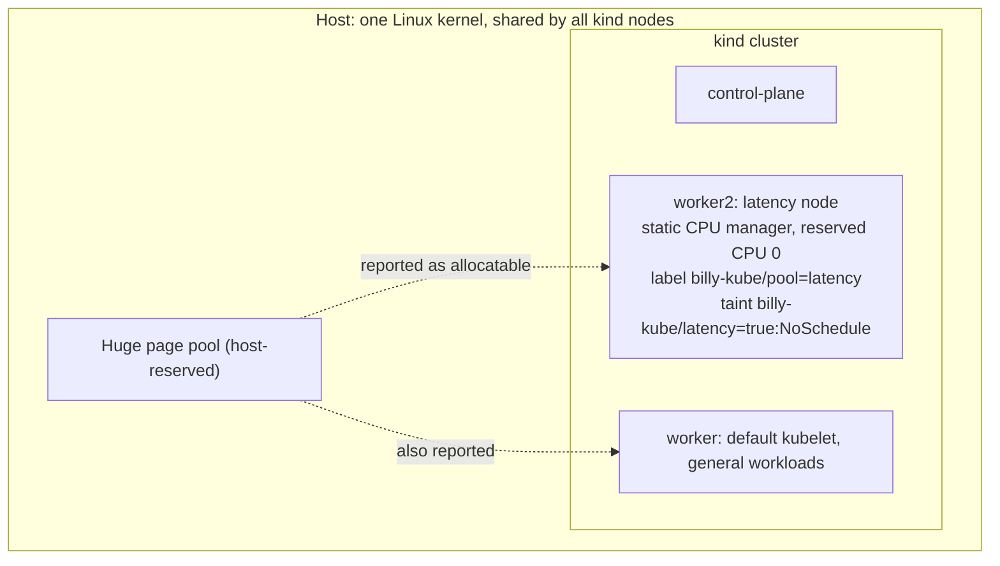
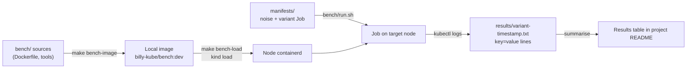

# 02 - Lab architecture

## Environments

| Environment | Used for | Not used for |
| --- | --- | --- |
| **WSL2** (development machine) | Building and validating configs, manifests and scripts; checking the tuning applies (cpusets, CPU manager state, allocatable huge pages, Cilium status) | Published latency numbers: CPUs are virtual, Windows scheduling noise leaks in, and the stock kernel lacks some networking modules |
| **Bare-metal Linux** (spare laptop, Ubuntu/Debian + Docker + kind) | Benchmark runs for P01 and P03; host tuning (`isolcpus`, `nohz_full`, `irqaffinity`, governor, SMT/turbo) | - |
| **Cloud sandbox** (Claude Code sessions) | Unit tests, linting, image builds and script smoke tests | Cluster runs: nested runc inside kind nodes fails there |

Cluster configs and scripts are shared between WSL2 and bare metal. Differences are expressed as `make` variables, never as separate copies of a config.

## Cluster topology

- **Base cluster** (`cluster/kind/base.yaml`): control plane + one worker, default kubelet and CNI.
- **Tuned cluster** (`cluster/kind/isolated-cpu.yaml`, P01): adds the latency node above.
- **CNI clusters** (P03): one with the default CNI (kindnet), one with `disableDefaultCNI: true` and Cilium in eBPF mode with kube-proxy replacement.
- **Multus cluster** (P02): base cluster plus Multus and a secondary-network plugin.

### Known limits of the kind topology

- All nodes share the host's CPUs and kernel. The static CPU manager isolates CPUs only among pods on the same node; processes on other nodes or on the host can still run on "exclusive" CPUs. Real isolation needs host boot parameters (bare metal), or k3s running directly on the host.
- Every node reports the host's huge page pool as its own capacity, so kubelets can over-commit it between them.
- Pods are nested containers inside node containers, which adds a layer to every measurement.

## Benchmark pipeline

Each run writes raw output to `results/`. Summaries in project READMEs are derived from those files, never typed in by hand.

## Repo layout

| Path | Purpose |
| --- | --- |
| `cluster/` | Shared cluster configs (kind, k3s) |
| `linux-fundamentals/` | LF experiments and notes |
| `projects/0N-*/` | One folder per project: `README.md` (hypothesis, method, results, takeaways), `manifests/`, `bench/`, `results/` |
| `scripts/` | Shared helpers (host setup, result collection) |
| `docs/prd/` | This PRD |
| `docs/` | Lab logs and short notes; reusable ones graduate to billy-notes |

## Shared lab functional requirements

These apply to every project. Project-specific functional requirements are in the project files.

### Cluster lifecycle

| ID | Requirement | Priority | Status |
| --- | --- | --- | --- |
| LAB-01 | `make cluster-up` / `make cluster-down` create and delete the base kind cluster; `CLUSTER` and `KIND_CONFIG` override the name and config. | Must | **Partial**: targets exist; not yet run on WSL2 |
| LAB-02 | Each project that needs a different topology has its own config under `cluster/` and its own `make` target (e.g. `make cluster-up-tuned`). | Must | **Partial**: P01 config and target exist; not yet run |
| LAB-03 | Host prerequisites that kind can't set (huge pages, sysctls) are applied by idempotent scripts under `scripts/` with a matching undo (`make hugepages-on` / `hugepages-off`). | Must | **Partial**: `scripts/hugepages.sh` exercised in the cloud sandbox; not yet on WSL2 |
| LAB-04 | A preflight check (`make preflight`) reports CPU count, cgroup version, huge page pool, kind/kubectl versions and, for P03, required kernel options. It fails with a fix hint when a prerequisite is missing. | Should | Planned |
| LAB-05 | A k3s setup for the bare-metal host, so the kubelet's CPU manager runs directly on the host instead of inside a node container. | Could | Planned; see open questions in [04-roadmap.md](04-roadmap.md) |

### Benchmark harness

| ID | Requirement | Priority | Status |
| --- | --- | --- | --- |
| LAB-10 | Benchmark images are built locally (`make bench-image`) and loaded into kind (`make bench-load`); no registry needed. | Must | **Partial**: Dockerfile and targets exist; image build not yet verified end to end |
| LAB-11 | A runner applies one variant, waits for completion with a timeout, and saves logs to `results/<variant>-<UTC timestamp>.txt`. | Must | **Partial**: `bench/run.sh` (P01), exercised against a stub `kubectl` (pass and discard paths); not yet run on a cluster |
| LAB-12 | Benchmark tools print one `key=value` line per measurement, so results can be parsed without screen-scraping. | Must | **Done**: `bench/bench.sh` smoke run, output in the P01 README |
| LAB-13 | Each result file starts with an environment record (see NFR-10). | Must | **Partial**: `scripts/env-record.sh`, written first in every result by `bench/run.sh`; cluster fields not yet seen on a real cluster |
| LAB-14 | A summariser turns a set of result files into a Markdown table of medians and spread per variant (`make summarise`). | Should | **Done**: `make summarise`; tested by `make test` (`scripts/summarise_test.py`) |
| LAB-15 | Benchmark runs fail loudly when the tuning they depend on is absent (e.g. a "tuned" pod that didn't get exclusive CPUs), instead of recording a misleading result. | Should | **Partial**: `bench/check-tuning.sh`, tested by `make test` against a stub `kubectl` (7 cases); not yet run on a cluster |
