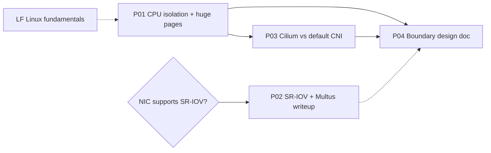

# 04 - Roadmap

## Sequencing

This track runs after the agentic-systems track's projects 1-4 (see billy-notes `kubernetes/agentic-systems-learning-track.md`). Within this track, the order is **P01 → P03 → P02 → P04**, with LF experiments done alongside P01 when they explain a P01 result.

| Phase | Scope | Exit criteria |
| --- | --- | --- |
| 0 | Scaffold | Repo layout, project stubs, base kind config. **Done.** |
| 1 | P01 + LF (affinity, cgroups, huge pages) | All P01 **Must** requirements done; bare-metal results with environment records in `results/`; P01 README results and takeaways written |
| 2 | P03 | Default CNI vs Cilium eBPF compared on bare metal, same-node and cross-node, with datapath checks |
| 3 | P02 | NIC checked; working Multus secondary interface on kind; SR-IOV writeup (real or mocked) |
| 4 | P04 | Design doc citing P01 and P03 results |
| 5 | Publication | Blog posts per project; reusable notes in billy-notes |

## Milestones

### P01: CPU isolation + huge pages + taints/tolerations
1. **Done.** Tuned kind config, bench image (cyclictest, memlat, stress-ng), noise Deployment, baseline and tuned Jobs, runner and `make` targets. Entrypoint and memlat smoke-tested outside a cluster.
2. **Done** (2026-10-29, on a bare-metal laptop instead of WSL2). Validate on a real cluster: cluster comes up, `make check-latency-node` shows the static policy, taint and allocatable huge pages; both variants complete; tuned pod gets exclusive CPUs and the noise pod's cpuset excludes them.
3. **Done.** Harness hardening: environment record (LAB-13), tuning checks that discard bad runs (LAB-15), summariser (LAB-14), `make lint` / `make test` and CI, green from its first run (NFR-40, NFR-41). Cluster-dependent parts are tested against a stub `kubectl` until milestone 2.
4. **Done** (2026-10-30). Bare-metal runs: host tuning (`isolcpus`, `nohz_full`, `irqaffinity`, performance governor, C-state limits, SMT/turbo) documented with revert; 3+ runs per variant, with and without host tuning.
5. **Next.** Writeup: results table, takeaways, blog post. (Results table and takeaways are in the P01 README; blog post pending.)

### LF: Linux fundamentals
1. CPU affinity: `taskset` pinned vs free-floating, under noise.
2. cgroups v2: cpuset and `cpu.max` by hand; CFS throttling and its effect on tail latency.
3. Huge pages: reservation, hugetlbfs, THP modes; reuse memlat.
4. NUMA: `numactl` locality, on the bare-metal host if it has more than one node.

### P03: Cilium/eBPF vs default CNI
1. Two cluster configs (kindnet; Cilium eBPF with kube-proxy replacement), versions pinned.
2. netperf/sockperf bench image and Jobs; same-node and cross-node, pod IP and Service IP.
3. Datapath checks (`cilium status`, kube-proxy absent, iptables rule counts).
4. Bare-metal runs and writeup.

### P02: SR-IOV + Multus
1. NIC check on the bare-metal laptop (`/sys/class/net/*/device/sriov_totalvfs`).
2. Multus on kind with a macvlan or ipvlan secondary network as the stand-in.
3. SR-IOV device plugin and CNI manifests, validated but marked not runnable without VFs (or run for real if the NIC allows).
4. Writeup with diagram.

### P04: Boundary design doc
1. Workload definition with latency budgets.
2. Placement per component, citing P01/P03 evidence.
3. Trade-offs, failure modes, alternatives; review pass.

## Deliverables

| Deliverable | When |
| --- | --- |
| Public repo with READMEs, configs, harness and results | Continuous |
| Blog post: "What CPU pinning and huge pages buy you on Kubernetes, measured" | End of phase 1 |
| Blog post: "Cilium eBPF vs the default CNI: pod-to-pod latency, measured" | End of phase 2 |
| Writeup: "SR-IOV and Multus without the hardware" | End of phase 3 |
| Design doc and post: "Where Kubernetes stops: placing a trading-adjacent system" | End of phase 4 |
| Notes graduated to billy-notes | As they come up |

## Risks

| Risk | Impact | Mitigation |
| --- | --- | --- |
| WSL2 hybrid cgroups stop recent kubelets | kind cluster never starts | `cgroup_no_v1=all` in `.wslconfig` (billy-notes `linux/cgroup-v1-vs-v2.md`); preflight check (LAB-04) |
| WSL2 kernel lacks networking modules | Cilium's iptables setup fails; P03 numbers skewed | Cilium eBPF-only mode on WSL2; real P03 numbers on bare metal (billy-notes `kubernetes/cilium-on-wsl2-explained.md`) |
| kind's shared kernel limits isolation | P01 tuned results understate what isolation can do | Host boot parameters on bare metal; consider k3s on the host (LAB-05) |
| Laptop turbo, thermal throttling and power management | Noisy, drifting numbers | Performance governor, turbo off, AC power, 3+ runs, record CPU frequency state |
| No SR-IOV NIC | P02 can't run for real | Planned as a mock from the start |
| Limited hobby time | Track stalls | Small milestones; agentic track takes priority by design; P02 is writeup-only if needed |

## Open questions

| Question | Needed by |
| --- | --- |
| On bare metal, kind or k3s for P01? k3s puts the CPU manager on the host and avoids the shared-kernel caveat. | P01 M4 |
| Does the bare-metal laptop have SMT, enough cores (6 or more) and more than one NUMA node? | P01 M4, LF 4 |
| Is a `PREEMPT_RT` kernel in scope for P01, or noted as future work? | P01 M4 |
| Baseline CNI for P03: kindnet only, or also Calico (iptables) as the more common production default? | P03 M1 |
| Primary P03 tool: netperf (`TCP_RR`, `UDP_RR`, `TCP_STREAM`), sockperf ping-pong, or both? | P03 M2 |
| Does the laptop NIC expose SR-IOV VFs? | P02 M1 |
| Where to publish the posts (dev.to vs personal site; see billy-notes `career/content-plan-blog-oss.md`) | Phase 1 deliverable |
